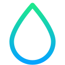

<!-- Improved compatibility of back to top link: See: https://github.com/othneildrew/Best-README-Template/pull/73 -->

<!-- PROJECT SHIELDS -->
<!--
*** I'm using markdown "reference style" links for readability.
*** Reference links are enclosed in brackets [ ] instead of parentheses ( ).
*** See the bottom of this document for the declaration of the reference variables
*** for contributors-url, forks-url, etc. This is an optional, concise syntax you may use.
*** https://www.markdownguide.org/basic-syntax/#reference-style-links
-->
[![Contributors][contributors-shield]][contributors-url]
[![Forks][forks-shield]][forks-url]
[![Stargazers][stars-shield]][stars-url]
[![Issues][issues-shield]][issues-url]
[![Unlicense License][license-shield]][license-url]

<!-- PROJECT LOGO -->
 

  

  <h3 align="center">Puddle</h3>

  

    A simple self hosted chat with no servers in the middle.
  

<!-- TABLE OF CONTENTS -->

  
Table of Contents

  <ol>
    <li>
      <a href="#about-the-project">About The Project</a>
      <ul>
        <li><a href="#built-with">Built With</a></li>
      </ul>
    </li>
    <li>
      <a href="#getting-started">Getting Started</a>
      <ul>
        <li><a href="#prerequisites">Prerequisites</a></li>
        <li><a href="#installation">Installation</a></li>
      </ul>
    </li>
    <li><a href="#usage">Usage</a></li>
    <li><a href="#roadmap">Roadmap</a></li>
    <li><a href="#contributing">Contributing</a></li>
    <li><a href="#license">License</a></li>
    <li><a href="#contact">Contact</a></li>
    <li><a href="#acknowledgments">Acknowledgments</a></li>
  </ol>

<!-- ABOUT THE PROJECT -->
## About The Project

[![Puddle demo][product-screenshot]](images/demo.gif)

Puddle allows you to run your own chats directly on your computer without any 
servers inbetween.

You add your friends directly by their IP and port, and chat over the internet 
the way chat was originally intended to run.

Getting starts is as simple as running the app on your computer and forwarding a
port.

(<a href="#readme-top">back to top</a>)

### Built With

* [![C][C-lang]][C-url]
* [![Qt][Qt-badge]][Qt-url]
* [![OpenSSL][OpenSSL-badge]][OpenSSL-url]
* [![libyaml][libyaml-badge]][libyaml-url]
* [![CMake][CMake-badge]][CMake-url]

The core (storage, identity, streams, the HTTPS server) is plain C11 on 
OpenSSL 3, shared by `puddled`, the headless Puddle, and by the desktop app, 
which is Qt 6 (Quick/QML). Configuration and profiles are YAML, read with 
libyaml.

(<a href="#readme-top">back to top</a>)

<!-- GETTING STARTED -->
## Getting Started

Getting starts is as simple as downloading the binary from [our releases][releases-url]
and running it in the environment you with to run it on.

You can preconfigure with the configuration file.

### Prerequisites

TBD

You'll need Qt headers to run though.

### Installation

There are no official installation steps just yet. We just ship compiled 
binaries for you to run.

(<a href="#readme-top">back to top</a>)

<!-- USAGE EXAMPLES -->
## Usage

TBD

<!-- ROADMAP -->
## Roadmap

- [x] Basic direct messages
- [x] Basic group messages
- [ ] Configurable profiles
- [ ] Images, emojis
- [ ] Voice, video
- [ ] Improved server-client experience
- [ ] iPhone and Android apps
- [ ] Community servers, with voice/video lobbies

See [open issues](https://github.com/othneildrew/Best-README-Template/issues)
for a full list of proposed features (and known issues).

(<a href="#readme-top">back to top</a>)

<!-- CONTRIBUTING -->
## Contributing

Per Sloporations corporate policies, we only accept AI slop as contributions.
If you do hand write code, please pass it through an LLM for slopification.

There are no hard rules on contributions however if you have stumbled upon this 
project and wish to contribute code, please do be advised that token usage for 
this project is signficantly higher than most typical projects.

This project alone has consumed some 60% of my weekly token usage in about three 
days. I had to switch to Sonnet and start limiting my usage.

<!-- LICENSE -->
## License

Distributed under the Unlicense License. See `LICENSE.txt` for more information.

(<a href="#readme-top">back to top</a>)

<!-- CONTACT -->
## Contact

Just create Github issues.

(<a href="#readme-top">back to top</a>)

<!-- MARKDOWN LINKS & IMAGES -->
<!-- https://www.markdownguide.org/basic-syntax/#reference-style-links -->
[contributors-shield]: https://img.shields.io/github/contributors/sloporation/puddle.svg?style=for-the-badge
[contributors-url]: https://github.com/sloporation/puddle/graphs/contributors
[forks-shield]: https://img.shields.io/github/forks/sloporation/puddle.svg?style=for-the-badge
[forks-url]: https://github.com/sloporation/puddle/network/members
[stars-shield]: https://img.shields.io/github/stars/sloporation/puddle.svg?style=for-the-badge
[stars-url]: https://github.com/sloporation/puddle/stargazers
[issues-shield]: https://img.shields.io/github/issues/sloporation/puddle.svg?style=for-the-badge
[issues-url]: https://github.com/sloporation/puddle/issues
[license-shield]: https://img.shields.io/github/license/sloporation/puddle.svg?style=for-the-badge
[license-url]: https://github.com/sloporation/puddle/blob/master/LICENSE.txt
[product-screenshot]: images/demo.gif
[C-lang]: https://img.shields.io/badge/C11-A8B9CC?style=for-the-badge&logo=c&logoColor=black
[C-url]: https://en.cppreference.com/w/c/11
[Qt-badge]: https://img.shields.io/badge/Qt_6-41CD52?style=for-the-badge&logo=qt&logoColor=white
[Qt-url]: https://www.qt.io/
[OpenSSL-badge]: https://img.shields.io/badge/OpenSSL_3-721412?style=for-the-badge&logo=openssl&logoColor=white
[OpenSSL-url]: https://www.openssl.org/
[libyaml-badge]: https://img.shields.io/badge/libyaml-555555?style=for-the-badge
[libyaml-url]: https://pyyaml.org/wiki/LibYAML
[CMake-badge]: https://img.shields.io/badge/CMake-064F8C?style=for-the-badge&logo=cmake&logoColor=white
[CMake-url]: https://cmake.org/
